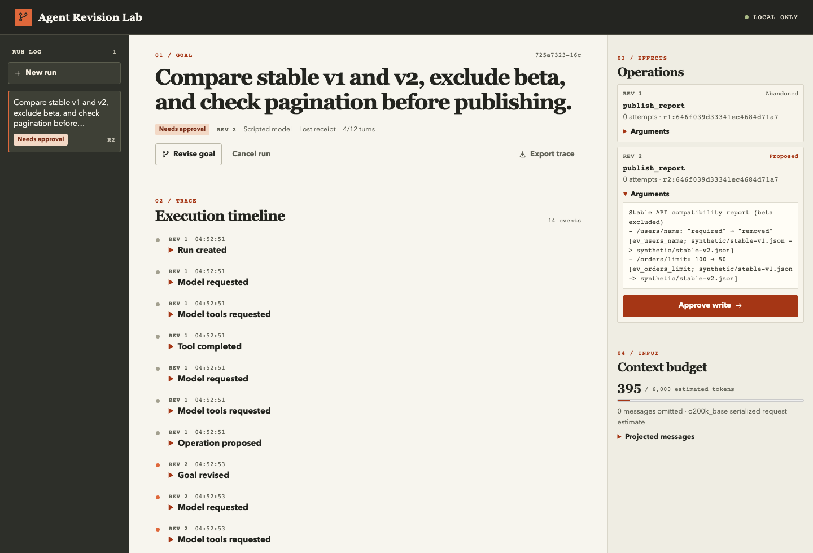

<div align="center">

# Agent Revision Lab

**Change the goal. Kill the worker. Account for every write.**

A TypeScript agent harness and local workbench for stale approvals,
uncertain tool outcomes, and crash recovery.

[](https://github.com/linkangjun/agent-revision-lab/actions/workflows/ci.yml)
[](LICENSE)

[Quick start](#try-it) · [Architecture](docs/architecture.md) · [中文 README](README.zh-CN.md) · [Contributing](CONTRIBUTING.md)

</div>



**Experimental alpha.** Designed for a trusted, single-user local environment. The default model is scripted and the API documents and report service are synthetic. It is not a production multi-tenant service, a tool sandbox, or a claim of universal exactly-once execution.

## The failure this project makes visible

Your agent sends a write. The remote service commits it, but the worker dies before recording the receipt. Meanwhile, the user changes the goal.

Restarting the loop is easy. Deciding what is still authorized is harder.

Agent Revision Lab persists an operation intent before dispatch, binds human approval to the exact operation and goal revision, and queries uncertain outcomes before doing more work. A late receipt remains an auditable fact; it cannot complete a different goal. Without a lookup contract, the run waits for an operator's evidence instead of repeating the write.

## Try it

**Node.js 22.12+**, npm, and a supported native PostgreSQL binary platform (macOS/Linux/Windows). No model key or Docker required:

```sh
git clone https://github.com/linkangjun/agent-revision-lab.git
cd agent-revision-lab
npm ci
npm run demo
```

Open **http://127.0.0.1:4317**. The launcher starts a dedicated, ephemeral PostgreSQL server, API and separate DBOS worker. It does not connect to or change your existing databases. Stopping the demo removes that temporary database. If either child process exits, the launcher stops the entire demo and removes the temporary database too. To experiment with worker recovery, keep PostgreSQL running independently and restart a confirmed-stopped worker with the same executor ID; see [DBOS recovery](docs/dbos-notes.md#recovering-a-stopped-worker).

For persistent local storage, use an existing disposable Postgres database via `DATABASE_URL`, or the included Compose definition:

```sh
docker compose up --build
# Stop while preserving the named database volume:
docker compose down
```

Compose binds the workbench to localhost and does not publish Postgres. Its isolated development database uses trust authentication. Do not expose this configuration to a network or use it for production. The native Node/Postgres path is tested; see [validation](docs/validation.md) for the current Compose validation boundary.

### Three experiments

1. **Clean:** create a run, read the evidence and proposed report, approve it, see the confirmed receipt.
2. **Lost receipt:** the demo service commits the report and closes the connection. The worker queries the same operation and recovers without another POST.
3. **No lookup:** the same uncertain write has no lookup contract. The run waits. Inspect the synthetic report and record an explicit manual resolution; it does not silently retry.

Try **Revise goal** before approval. Old proposals become abandoned and require a new approval. The automated crash test goes further: it kills a real worker after the remote commit, revises the goal, and starts a replacement worker. The old operation is reconciled without advancing the new revision.

## What is implemented

| Area | In this alpha |
| --- | --- |
| Agent loop | Explicit stop reasons, paired tool calls/results, bounded model turns, deadline and per-call timeout; truncated arguments never execute |
| Harness | Strict JSON Schema validation, tool allowlist, per-operation approval, bounded read retries, no automatic write redispatch |
| Context | Trusted goal/version, grouped history, retained write receipts, tool-schema-aware token estimate, fail-closed oversized input |
| Recovery | Postgres operation ledger, DBOS durable steps, real `SIGKILL` regression, stale-result handling, operator reconciliation |
| Deployment | Separate API/worker processes, shared Postgres, stable executor restart, explicit stopped-executor recovery |
| Workbench | Goal revision, approval, timeline, context inspection, manual reconciliation, execution-error retry, redacted incident metadata |

**Not yet claimed:** 10,000-agent capacity, automatic cross-worker failure detection, production authentication or tenant isolation, arbitrary-code isolation, exact provider token accounting, end-user adoption, or real-model quality benchmarks. The queue is capped at eight active workflows. Approval and reconciliation waits finish their short execution and release its slot; commands start a new execution and a separate durable deadline job expires unattended runs unless an in-flight write or execution error needs recovery first. This does not establish per-tenant fairness or throughput. See [roadmap](docs/roadmap.md).

## A small core, a durable backend

```text
Model → validated tool call → revision-bound approval → persisted intent
                                                        ↓
                                               external tool service
                                                        ↓
                     next model turn ← confirmed receipt / explicit uncertainty
```

- [`src/engine.ts`](src/engine.ts): the loop and recovery decisions.
- [`src/core.ts`](src/core.ts): context projection, parameter validation, deadlines, read retries.
- [`src/store.ts`](src/store.ts): atomic commands, revision snapshots, approvals and event history.
- [`src/durable.ts`](src/durable.ts): DBOS execution; no second task queue.
- [`tests/integration/durable.test.ts`](tests/integration/durable.test.ts): actual worker death and external HTTP call counts.

The example compares two synthetic API versions. Its completion contract requires reading evidence, proposing a cited report, and confirming an approved publication. It is a reference harness to study and extend, not a generic agent SDK with a stable public API yet. Adapting it to a real tool requires an explicit effect and reconciliation contract; see [architecture](docs/architecture.md).

## Optional real model

Set `OPENAI_API_KEY` and an explicitly chosen `OPENAI_MODEL` in your shell, then launch the demo and select OpenAI. The adapter uses Chat Completions, tool calls and a 1,000-token output cap. The key stays in server/worker process environment and is not sent to the browser.

The wire protocol is tested with mocked responses. **No paid live model validation is claimed.** Token budgeting uses a labelled `o200k_base` estimate, not the provider's authoritative usage count. Account charges and provider rate limits remain your responsibility; model support varies.

## Verify the behavior

```sh
npm run verify             # TypeScript, unit/UI tests, production build
npm run test:integration    # disposable native PostgreSQL + real child workers
```

The integration runner creates its own temporary cluster unless `ARL_TEST_DATABASE_URL` is supplied. Use only a dedicated test database. It verifies both final state **and the number of actual outbound write requests**.

With the demo running and Microsoft Edge installed:

```sh
ARL_E2E_URL=http://127.0.0.1:4317 node tests/e2e/smoke.mjs
```

This launches a separate headless test browser; it does not use your personal browser profile. The browser smoke is a local release check; CI separately runs unit and real-Postgres integration tests. [Validation notes](docs/validation.md) distinguish mocked inference, real Postgres/HTTP/process faults, browser tests, and untested deployment claims.

## Where this fits

Pi, LangGraph, DBOS, Temporal and Restate already offer important execution or recovery capabilities. Agent fault injection tools also exist. This project does not claim to invent those concepts. It concentrates on how **goal revisions, approvals and uncertain writes interact**, with an inspectable reference implementation and regression scenarios.

Pi's loop and context design informed the research; this code is independently implemented. DBOS provides the durable execution substrate. [References and attribution](docs/references.md).

Ideas and reproducible failures are welcome. Please open an issue with a **sanitized** scenario and the invariant you expected. Do not upload credentials, production prompts or confidential documents. The export omits goal/prompt/report bodies and operator notes, but identifiers and hashes remain; inspect any report before sharing it.
