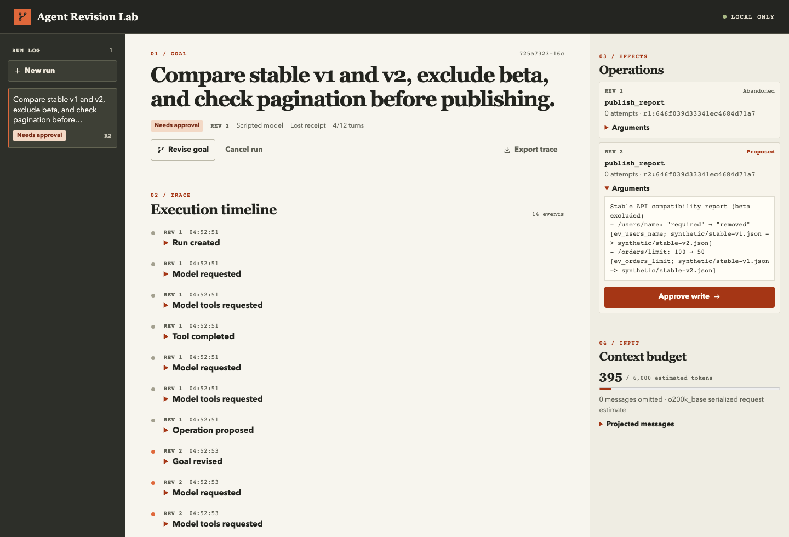

<div align="center">

# Agent Revision Lab

**修改目标，终止 Worker，查清每一次写入的结果。**

一个用 TypeScript 实现的 Agent 执行框架和本地工作台，用来观察目标变更、旧审批失效、写入结果未知与崩溃恢复如何相互影响。

[](https://github.com/linkangjun/agent-revision-lab/actions/workflows/ci.yml)
[](LICENSE)

[快速开始](#快速开始) · [架构说明](docs/architecture.md) · [中文操作指南](docs/zh-CN.md) · [English](README.md) · [参与贡献](CONTRIBUTING.md)

</div>



**实验性 Alpha。** 面向可信单用户的本地环境。默认使用脚本模型、合成 API 文档和演示报告服务。当前没有面向生产环境的多租户隔离，也没有用于运行任意工具的沙箱；不保证任意外部工具都能恰好执行一次。

## 这个项目演示什么

Agent 发出写请求，外部服务已完成写入，Worker 却在记录回执前崩溃。与此同时，用户修改了任务目标。重启后，系统怎样查清上一笔写入的结果？哪一项操作还在用户批准的范围内？

Agent Revision Lab 在发出写请求前保存操作意图，并把人工批准绑定到具体操作、目标版本和参数。结果未知时，系统先查询原操作。迟到的回执可以作为审计记录，但不能推进新版本的目标。外部工具没有查询接口时，任务会等待人工核实，不会自动重发写请求。

## 快速开始

准备 **Node.js 22.12 或以上版本**和 npm，并确认当前 macOS、Linux 或 Windows 平台有可用的原生 PostgreSQL 二进制包。默认演示不需要模型 API Key 或 Docker。

```sh
git clone https://github.com/linkangjun/agent-revision-lab.git
cd agent-revision-lab
npm ci
npm run demo
```

打开 [http://127.0.0.1:4317](http://127.0.0.1:4317)。未设置 `DATABASE_URL` 时，启动器会创建专用临时 PostgreSQL 实例，并分别启动 API 和 DBOS Worker。停止整套演示会删除临时数据。任一子进程退出时，启动器也会关闭整套演示并删除临时数据库。要实验 Worker 恢复，必须独立保留 PostgreSQL，并在确认原 Worker 已停止后使用相同执行器 ID 启动替代进程，详见 [DBOS 恢复说明](docs/dbos-notes.md#recovering-a-stopped-worker)。

要保留本地运行记录，可以把 `DATABASE_URL` 指向专用的可丢弃 PostgreSQL 数据库，或使用仓库附带的 Docker Compose 配置：

```sh
docker compose up --build
# 停止服务并保留数据库命名卷：
docker compose down
```

Compose 将工作台绑定到本机回环地址，数据库端口不发布到宿主机。数据库在 Compose 网络内使用开发用的 trust 认证，仅适合本地演示。[验证记录](docs/validation.md)说明了 CI 对 Compose 启动和 API/Worker 的验证范围。

### 三个可复现的实验

1. **Clean run（正常运行）**：创建任务，查看证据和报告提案，批准写入，再查看确认回执。
2. **Lost receipt（回执丢失）**：演示服务保存报告后主动断开响应。Worker 查询同一笔操作，找回回执，无需再次发出 POST 请求。
3. **No lookup（无法查询）**：结果未知且没有查询接口时，任务等待人工对账。核实演示报告后，通过 **Reconcile outcome** 记录结论和依据。对账不会再写入或撤销原操作。

也可以在批准前点击 **Revise goal** 修改任务。旧提案会被作废，新提案需要重新批准。崩溃恢复测试会在外部写入成功后终止真实 Worker，修改目标，再启动替代 Worker，验证旧操作可以完成对账，但不会推进新目标。

## 已实现的能力

| 模块 | Alpha 当前能力 |
| --- | --- |
| Agent 循环 | 工具调用和结果按 ID 配对；有明确的停止原因、模型轮数上限、总截止时间和单次超时；参数被截断时不执行工具 |
| 工具控制 | 严格的 JSON Schema 参数校验、工具白名单、逐笔人工批准、有上限的只读重试；不自动重发写请求 |
| 上下文 | 使用可信的目标和版本，成组裁剪历史，保留写入回执；预算估算计入工具定义，必要内容超预算时停止 |
| 崩溃恢复 | PostgreSQL 操作账本、DBOS 持久化步骤、真实 `SIGKILL` 回归测试、旧结果处理和人工对账 |
| 运行部署 | API 与 Worker 分进程并共享 PostgreSQL；支持使用同一执行器 ID 重启，或显式恢复已确认停止的执行器所遗留的任务 |
| 工作台 | 修改目标、批准操作、查看时间线和上下文、手动对账、重试失败执行，以及导出脱敏诊断记录 |

队列最多同时运行 8 个工作流。等待审批或对账时，当前短执行结束并释放名额；新命令启动新的执行，独立的持久化到期任务负责无人操作时的过期处理；存在进行中的写入或执行错误时，先保留恢复入口。这不代表已实现租户公平调度或验证吞吐量。当前没有自动检测其他 Worker 故障的能力，也未验证万级并发、生产身份认证与隔离、供应商精确 token 计数、真实模型质量或用户采用情况。后续方向见[路线图](docs/roadmap.md)。

## 从哪里读源码

```text
模型 → 校验工具调用 → 绑定目标版本的审批 → 持久化操作意图
                                          ↓
                                    外部工具服务
                                          ↓
            确认回执 → 下一轮模型输入
            结果未知 → 查询原操作或等待人工对账
```

- [`src/engine.ts`](src/engine.ts)：执行循环与恢复决策。
- [`src/core.ts`](src/core.ts)：上下文组装、参数校验、截止时间与只读重试。
- [`src/store.ts`](src/store.ts)：原子命令、目标版本快照、审批和事件历史。
- [`src/durable.ts`](src/durable.ts)：使用 DBOS 执行工作流。
- [`tests/integration/durable.test.ts`](tests/integration/durable.test.ts)：真实 Worker 崩溃、恢复和实际 HTTP 请求计数。

示例比较两个合成的 API 版本。完成任务需要读取证据、提出带引用的报告，并确认批准后的发布结果。当前代码适合阅读和扩展，尚未提供稳定的通用 Agent SDK。接入真实工具前，应明确外部写入的幂等和对账契约，详见[架构说明](docs/architecture.md)和 [DBOS 恢复说明](docs/dbos-notes.md)。

## 可选：接入真实模型

在启动演示的终端中设置 `OPENAI_API_KEY` 和明确指定的 `OPENAI_MODEL`，然后在工作台选择 **OpenAI**。适配器使用 Chat Completions 和工具调用，输出上限为 1,000 token。密钥留在服务端和 Worker 的进程环境中，不会发送到浏览器。

已用模拟 HTTP 响应验证协议，尚未验证付费真实模型。上下文预算使用 `o200k_base` 估算，实际计数以供应商为准。模型支持情况、费率和调用限制也由供应商决定。

## 如何验证

```sh
npm run verify             # 类型检查、单元与界面测试、生产构建
npm run test:integration   # 临时 PostgreSQL 和真实 Worker 子进程
```

集成测试默认创建独立的临时数据库实例。如果提供 `ARL_TEST_DATABASE_URL`，请只使用专用且可丢弃的测试库。集成测试同时检查最终状态和**实际发出的 HTTP 写请求数量**。

演示运行后，如果本机安装了 Microsoft Edge，可单独运行浏览器验证：

```sh
ARL_E2E_URL=http://127.0.0.1:4317 node tests/e2e/smoke.mjs
```

脚本使用独立的无头浏览器，不会读取个人浏览器配置。[验证记录](docs/validation.md)区分了模拟模型请求、真实 PostgreSQL/HTTP/进程故障、浏览器验证和未覆盖的部署能力。

## 项目定位与反馈

Pi、LangGraph、DBOS、Temporal 和 Restate 已提供各自的执行或恢复能力，也已有专门的 Agent 故障注入工具。本项目关注**目标变更、人工批准和不确定写入如何在同一次执行中交互**，并通过可查看的时间线和回归场景展示这些行为。Pi 的循环和上下文设计启发了前期研究，本项目独立实现执行逻辑，持久化工作流由 DBOS 提供。[参考资料与致谢](docs/references.md)。

欢迎通过 [GitHub Issues](https://github.com/linkangjun/agent-revision-lab/issues) 提交脱敏后的复现步骤和预期行为。导出的诊断记录省略目标、提示词、报告正文和操作员备注，但仍保留部分标识和哈希，分享前请检查，勿上传密钥或生产数据。项目采用 [MIT 许可证](LICENSE)。
