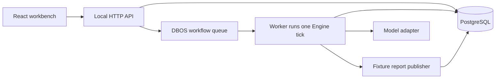

# Agent Revision Lab architecture

Agent Revision Lab 0.1.0-alpha.1 is a single-user, local workbench for a synthetic API compatibility review. It demonstrates what happens when an agent's goal changes while an approved tool call is in flight. The default model is scripted. The OpenAI Chat Completions adapter has simulated HTTP protocol tests; this release has no live model evaluation.

## One tick at a time

The [engine](../src/engine.ts) reads the run and resolves the next pending action. A model turn returns final text, tool calls, or a truncation signal. The engine executes calls in order and appends a result with the original call ID. Truncated output cannot dispatch a tool. The engine enforces a run deadline and a turn budget; final text counts as success only after a report for the current revision has been confirmed.

[Tool validation](../src/core.ts) rejects unknown tools and invalid arguments without type coercion. The engine also checks the configured tool allowlist. The report tool requires evidence IDs from the current revision and an explicit approval. Tools are registered in code; the workbench does not run arbitrary shell commands.

## Revision and approval

The [store](../src/store.ts) serializes commands on the run row. Each command carries a `commandId` and an `expectedRevision`. Repeating the same ID and payload returns the recorded result; reusing the ID with different input or submitting an outdated revision yields a conflict. A goal edit atomically archives the previous run snapshot in `arl_revisions`, increments the revision, clears the active model history and pending calls, and abandons unstarted proposals or approvals from the prior goal. In-flight and uncertain operations remain in the ledger. Archived snapshots are available through the local-only `GET /api/runs/:id/revisions` endpoint and are excluded from incident exports.

An approval is for one operation in one revision. Its stored argument hash binds it to the exact canonical JSON payload. The worker checks the current revision, operation state, expiry, and argument hash when claiming the write. Changing the goal or cancelling the run cannot retract a request that has already been sent.

## Persistence and recovery

The API commits run creation and DBOS enqueue in one Postgres transaction. Commands that need to wake a worker commit their state change and notification together. The notification is a wake signal; the worker reads the current goal and approvals from Postgres.

Each tick is a DBOS step. Before dispatching a write, the engine records the intent as `IN_FLIGHT`. If the process exits or a reply is lost, a later tick first looks up the original operation. A matching receipt confirms the effect. A missing or unverifiable receipt leaves an `UNKNOWN` operation and parks the run for manual reconciliation. The worker does not automatically resend the write. The fixture publisher uses an operation ID and argument hash to deduplicate submissions; arbitrary external systems need their own idempotency and lookup contracts.

If an old revision's effect is confirmed, its receipt remains available in the timeline and ledger. It cannot become a tool result for the new revision. Manual reconciliation records what the operator verified externally; it does not issue or undo the underlying write.

DBOS is the only task queue. A Postgres advisory lock serializes ticks for a run, and an incrementing execution epoch protects application state mutations from an old worker. Neither can fence an external HTTP server. See [DBOS recovery notes](dbos-notes.md) for restart and explicit operator recovery procedures.

## Context and incident evidence

The engine projects the current goal and policy, recent model/tool history, and registered tool schemas into each model request. It keeps calls and their results together. To fit the budget, it drops older read-only blocks and preserves the most recent block and blocks containing writes. If the required material is too large, it stops before contacting the model. The reported `o200k_base` count is an estimate of the serialized request, not a provider token count or a guarantee that a selected model will accept the request.

The workbench displays the current revision, operation states, and a chronological event trail. Its JSON trace export omits goals, prompts, tool inputs and outputs, reports, and operator notes. It retains diagnostic identifiers and hashes. It is a metadata export, not a replay of live model behavior.

## Verified scope and limits

- `npm run test:integration` exercises real Postgres. The process recovery case uses DBOS and a real worker `SIGKILL`, then starts a replacement with the same executor ID and verifies that the old effect is reconciled without another dispatch.
- The DBOS queue has a global concurrency limit of eight workflows. Workflows waiting for approval or reconciliation still occupy a slot. Multiple executors can pick up new work, but the alpha does not automatically detect or take over a different failed executor. There is no 10,000-run benchmark.
- `npm run demo` starts a temporary Postgres cluster unless a database URL is supplied. Stopping the default demo discards its data. The included Compose configuration uses a named volume and leaves Postgres unexposed on the host; the Compose path is not covered by the release's runtime verification.
- The API and workbench are for a trusted local user. The demo does not implement accounts, production tenant isolation, or a public service authentication boundary. The Compose database uses trust authentication inside the local Compose network.
